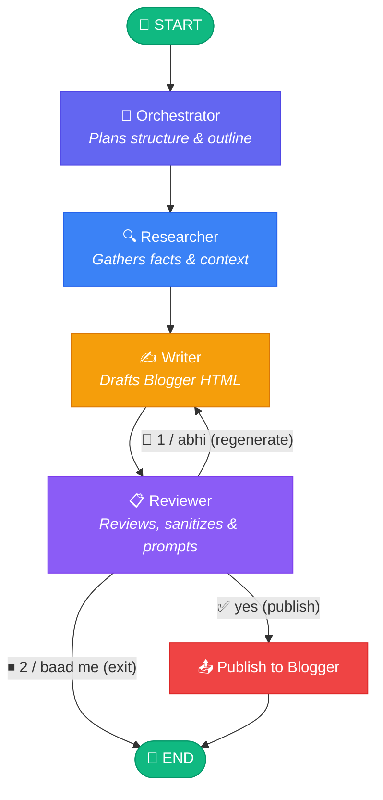

<div align="center">

# Auto Blog Multi-Agent System

### Autonomous Multi-Agent AI Blog Generation & Pre-Publishing Engine

[](https://python.org)
[](https://docs.astral.sh/uv/)
[](https://langchain-ai.github.io/langgraph/)
[](https://ai.google.dev)
[](LICENSE)
<br>
[](https://drive.google.com/file/d/1Vw9RoFcjUNmem3q32AWpMg0e5ogDc4e5/view?usp=sharing)

<br><br>

> **Target Platform:** [Google Blogger](https://www.blogger.com) (API v3 OAuth 2.0)  
> **Workflow:** LangGraph Cyclical Multi-Agent State Machine  
> **Demo Video:** [Watch Demo on Google Drive](https://drive.google.com/file/d/1Vw9RoFcjUNmem3q32AWpMg0e5ogDc4e5/view?usp=sharing)

</div>

---

## 🔍 Overview

Auto Blog is a terminal-based AI application that transforms any idea or topic into structured, well-researched blog posts, evaluates and refines them from multiple agent perspectives, and publishes them directly to Google Blogger with human-in-the-loop approval.

Built with **Python**, **LangGraph**, **Google Gemini**, and the **Blogger API**, Auto Blog coordinates four specialized AI agents through a graph-based workflow:

1. **Orchestrator** — Converts the user's topic prompt into a structured content outline, identifying the target audience, key questions, and logical section hierarchy.
2. **Researcher** — Gathers up-to-date facts, context, and domain knowledge to back up the post with accurate details.
3. **Writer** — Synthesizes the outline and research into a complete, Blogger-ready HTML article using semantic structure (headings, paragraphs, bullet points, and code blocks).
4. **Reviewer** — Polishes the draft for clarity, structure, and readability, sanitizes the HTML against prohibited tags, and presents a formatted terminal preview with review notes.

### Human-in-the-Loop Decision Gate

Publishing is always gated by your explicit approval:
- **`yes`** — Immediately publishes the live post to your Google Blogger blog via the Blogger API v3.
- **`no`** — Prompts for next steps:
  - **`1` (Abhi / Now)**: Loops back to the Writer to regenerate an improved draft incorporating the Reviewer's feedback.
  - **`2` (Baad me / Later)**: Closes the workflow cleanly without saving any unwanted draft files to disk.
- **`exit`** — Cancels the workflow and returns to topic input.

---

## 🏗 Architecture

Auto Blog uses **LangGraph** to coordinate agent execution through an explicit `StateGraph`. A shared, typed state dictionary (`BlogState`) flows between nodes, maintaining planning notes, research findings, article content, and review feedback.



### Workflow Execution Mechanics

1. `main.py` compiles the `StateGraph` containing agent nodes (`orchestrator`, `researcher`, `writer`, `reviewer`) and the service node (`publish`).
2. Conditional edge routing via `next_step()` evaluates the Reviewer's state:
   - If `approved == True`: routes to `publish`.
   - If `cancelled == True`: routes directly to `END`.
   - If `approved == False` (and not cancelled): loops back to `writer`.
3. When regenerating, the Writer receives the previous `review` notes in its prompt, enabling iterative refinement across cycles.

---

## ✨ Key Features

- **Multi-Agent Orchestration**: Coordinates four specialized agents (Orchestrator, Researcher, Writer, Reviewer) through a cyclical LangGraph state machine.
- **Human-in-the-Loop Review**: Gated publishing mechanism requiring your explicit approval, with terminal preview and editorial critique notes.
- **Iterative Feedback Loop**: Injects reviewer critique back into the Writer agent to progressively refine and improve rejected drafts.
- **Flexible Rejection Handling**: Choose to regenerate an article immediately (`Abhi`) or cleanly exit the session to resume later (`Baad me`).
- **Proactive HTML Sanitization**: Automatically strips scripts, iframes, and active elements to guarantee safe, compliant Blogger HTML.
- **Direct Blogger Publishing**: Authenticates via Google OAuth 2.0 with automatic token refresh, recovery, and interactive blog selection.
- **Zero Disk Clutter**: Runs cleanly without leaving orphan draft files, unapproved HTML, or unused log directories on your machine.
- **Fast Package Management**: Built with `uv` for lightning-fast virtualenv creation and deterministic dependency locking.

---

## 🛠 Technology Stack

| Technology | Purpose |
|:-----------|:--------|
| **Python 3.11+** | Core programming language and agent runtime |
| **LangGraph** | Workflow orchestration, graph-based routing, and state management |
| **Google GenAI SDK** | Gemini 3.5 Flash / Flash Lite for content planning, research, writing, and editorial review |
| **Google APIs Client** | Official Google Blogger API v3 client for live blog publishing |
| **Google Auth OAuthlib** | OAuth 2.0 Desktop authentication with local token caching and automatic refresh |
| **python-dotenv** | Environment variable management for API keys and configurations |
| **uv** | Ultra-fast Python project and dependency management |

---

## 📁 Project Structure

```
Auto_blog_multi_agent_system/
├── agents/                        # AI agent modules
│   ├── __init__.py
│   ├── common.py                  # Shared BlogState TypedDict & Gemini helper routines
│   ├── orchestrator.py            # Content planning and structuring agent
│   ├── researcher.py              # Information gathering and fact-checking agent
│   ├── writer.py                  # Blogger-ready HTML drafting agent (with feedback loop)
│   └── reviewer.py                # Editorial review, HTML sanitization, and approval gate
│
├── services/                      # External service integrations
│   ├── __init__.py
│   └── blogger_client.py          # Google OAuth, token management, and Blogger publishing
│
├── main.py                        # LangGraph workflow compilation and terminal CLI loop
├── check_gemini.py                # Health check utility for verifying Gemini API access
├── pyproject.toml                 # Project metadata and dependencies
├── uv.lock                        # Deterministic dependency lockfile
├── .env                           # Environment configuration (API keys)
├── .gitignore                     # Git ignore rules for secrets and caches
├── credentials.json               # Google OAuth Desktop client secrets (downloaded by user)
├── token.json                     # OAuth access/refresh token cache (auto-generated)
└── README.md                      # Project documentation
```

### Module Responsibilities

- **`agents/`**: Contains pure-Python agent implementations. Each agent is a standalone function that accepts `BlogState` and returns a dictionary with state updates.
- **`services/`**: Encapsulates external API integrations. `blogger_client.py` handles OAuth token lifecycle, handles refresh failures, and interacts with the Google Blogger v3 API.
- **`main.py`**: Declares graph nodes, wires directional and conditional edges, sets recursion limits, and provides the terminal prompt loop.

---

## 🚀 Getting Started

### Prerequisites

- **Python 3.11+**
- **[uv](https://docs.astral.sh/uv/)** installed on your system
- A **[Google Gemini API Key](https://aistudio.google.com/)**
- A **Google Cloud Project** with **Blogger API v3** enabled and Desktop OAuth credentials downloaded

---

### 1. Clone the Repository

```bash
git clone https://github.com/your-username/Auto_blog_multi_agent_system.git
cd Auto_blog_multi_agent_system
```

---

### 2. Install Dependencies

Using `uv`, install all required packages into a local virtual environment:

```bash
uv sync
```

---

### 3. Configure Environment Variables

Create a `.env` file in the project root:

```env
GEMINI_API_KEY=your_gemini_api_key_here
GEMINI_MODEL=gemini-3.5-flash-lite
BLOGGER_BLOG_ID=your_optional_blog_id_here
```

| Variable | Required? | Description |
|:---------|:----------|:------------|
| `GEMINI_API_KEY` | **Yes** | Your API key from Google AI Studio |
| `GEMINI_MODEL` | No | Model name (default: `gemini-3.5-flash-lite`) |
| `BLOGGER_BLOG_ID` | No | Target Blogger blog ID. If left blank, you can select from a list in the terminal |

---

### 4. Configure Google Blogger OAuth

1. Open the [Google Cloud Console](https://console.cloud.google.com/).
2. Create a project and enable the **Blogger API v3** under **APIs & Services > Library**.
3. Configure the **OAuth consent screen** (User Type: **External**; add your Google account as a **Test User** if the app is in Testing mode).
4. Go to **APIs & Services > Credentials** > **Create Credentials** > **OAuth client ID**.
5. Select Application type: **Desktop app**.
6. Download the generated client JSON and save it in the project root as:
   ```
   credentials.json
   ```
7. Verify authentication:
   ```bash
   uv run main.py --check-blogger
   ```
   *Your browser will open automatically for initial sign-in. After authorizing, a `token.json` file will be created.*

---

### 5. Run Auto Blog

Start the interactive terminal session:

```bash
uv run main.py
```

---

## 🎯 Design Principles

- **Separation of Concerns**: Each agent has a single, well-defined role in the pipeline (planning, researching, writing, or reviewing).
- **Explicit State Management**: A single typed state dictionary (`BlogState`) tracks all pipeline artifacts and decisions with zero hidden side-effects.
- **Human Sovereignty**: AI drafts and critiques, but publishing is strictly blocked until explicit human consent is granted.
- **Iterative Feedback**: Editorial critiques are not discarded; they directly shape subsequent writing passes.
- **Safety by Default**: Active HTML sanitization safeguards against malicious scripts, hidden forms, and unauthorized embed tags before transmission.
- **Clean Workspace**: Avoids polluting the filesystem with unapproved scratch drafts or empty log folders.

---

## ⚠️ Scope and Limitations

- **CLI-Only Interface**: Currently operates purely through an interactive terminal interface without a web dashboard.
- **Platform Scope**: Tailored specifically for Google Blogger. Publishing to other platforms (WordPress, Medium, Dev.to) is not yet supported.
- **API Rate Limits**: Rapid regeneration cycles may consume Gemini API quota and hit provider rate limits (`429 RESOURCE_EXHAUSTED`).
- **Token Context Windows**: Extremely long topics or comprehensive multi-page articles may approach the token limits of smaller models.

---

## 🎥 Demo Video

Watch the complete walkthrough video showcasing the multi-agent workflow, iterative reviewer feedback loop, and automated publishing to Google Blogger:

[](https://drive.google.com/file/d/1Vw9RoFcjUNmem3q32AWpMg0e5ogDc4e5/view?usp=sharing)

> 🔗 **Direct Link:** [Watch Demo on Google Drive](https://drive.google.com/file/d/1Vw9RoFcjUNmem3q32AWpMg0e5ogDc4e5/view?usp=sharing)
